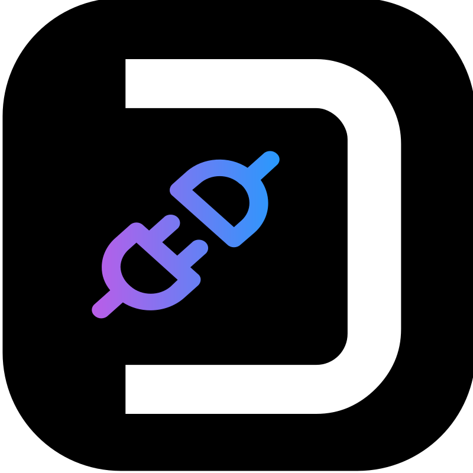
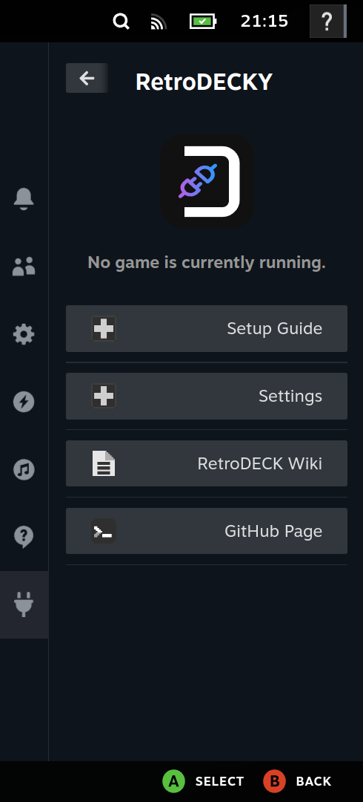
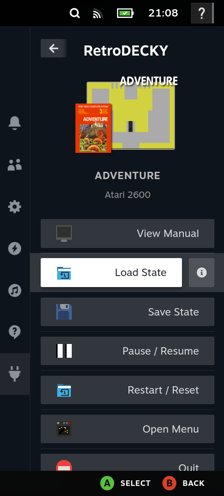
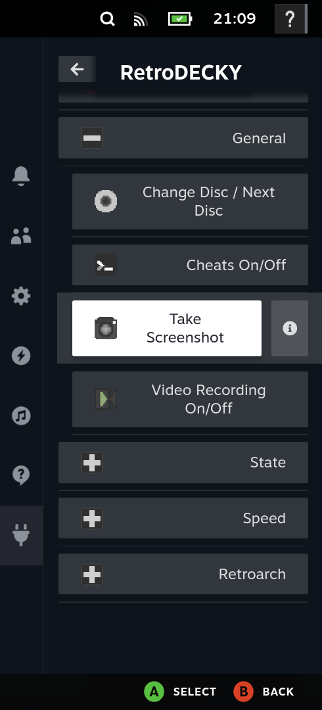
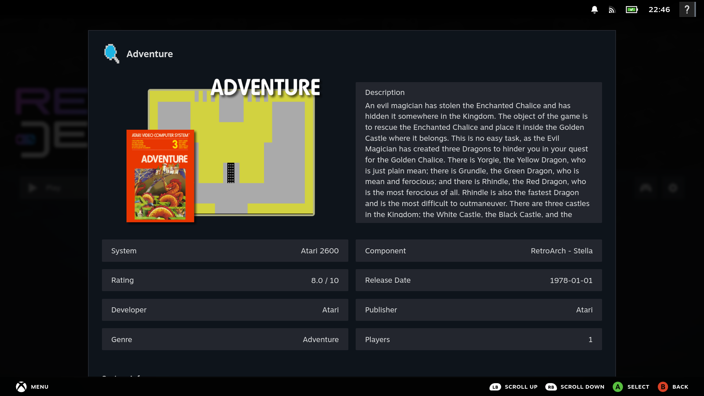
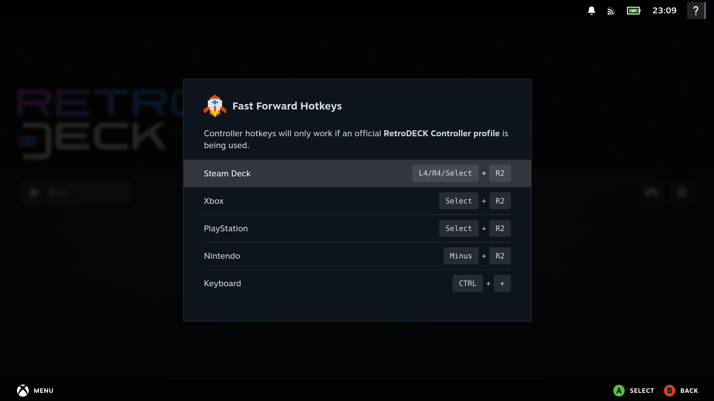
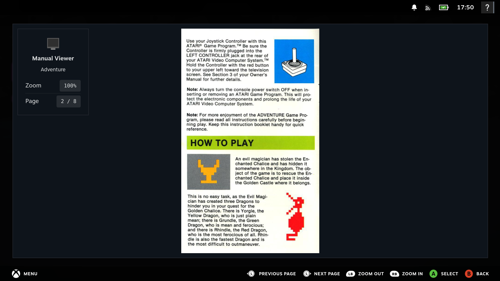
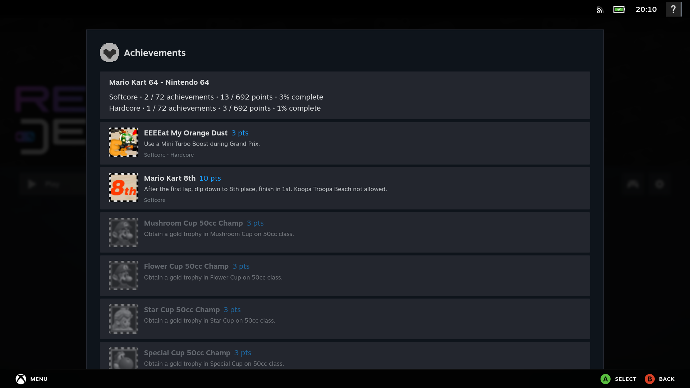

# RetroDECKY

  

**RetroDECKY** is a Decky Plugin for the all-in-on Retro Gaming Platform [RetroDECK](https://retrodeck.readthedocs.io/en/latest/). 

---

## Screenshots

  
  
  

  
  

  
  

---

## Purpose and Goal of RetroDECKY

RetroDECK provides multiple built-in **hotkey combinations** for interacting with the currently running component. It also supports **Steam Deck system hotkeys** and **Steam Input templates** that feature multitude of radial button submenus.

That approach present usability challenges:

- Users must remember multiple hotkey schemes across different components.
- Steam Input menus provide limited usability when displaying many actions.

RetroDECKY addresses these issues by providing a **content-aware** in-game menu that:

- Displays only actions relevant to the currently running component.
- Improves usability compared to large radial or input menus.
- Expands features not currently available or possible in RetroDECK (but might be in the future) like an in game manual viewer.

---

## Features

- **Running Game Actions** - Displays hotkey actions specific to the currently running game.

- **Running Game Information** - Displays data from ES-DE and RetroDECK such as artwork, covers and metadata.

- **Hotkey Triggering** - Execute hotkey functions through Decky menu buttons instead of keyboard hotkeys, button combos or radial menus.

- **Boot into RetroDECK** - A function to automatically start RetroDECK when Steam launches in Game Mode.

- **PDF Manual Viewer** - Read game manuals without leaving the game session.

- **Additional Documents** - Add PDF, TXT, or Markdown documents per game and view them during the game session

- **RetroAchievements** - View achievement progress for the currently running game, including softcore and hardcore mode

---

## Known Issues

- Hotkey actions requiring **held inputs** like fast-forward are currently not fully supported.
- Launching games directly via the Steam library is currently not supported.

---

## Requirements for RetroDECKY: Decky Loader & RetroDECK

Before you can install **RetroDECKY** ensure the following are installed:

### Install RetroDECK

RetroDECK must be installed before using the plugin.

- [RetroDECK Installation Guide](https://retrodeck.readthedocs.io/en/latest/wiki_general/retrodeck-start/)

Read the **Steam Deck** installation section.

### Install Decky Loader

Decky Loader is required to run the RetroDECKY plugin.

- [Decky Loader Website](https://decky.xyz/)
- [Decky Loader GitHub](https://github.com/SteamDeckHomebrew/decky-loader/)

---

## How-to: Install RetroDECKY

This requires that RetroDECK & Decky Loader is installed.

Choose one of the following methods:

### Install from the Decky Plugin Store (not available yet, but will be the recommended path)

Search for **RetroDECKY** in the **Decky Plugin Store** and press **Install**.

### Manual Install from Github

- Download and install from the **GitHub Releases page**
  1. Switch to desktop mode and open your browser
  2. Go to the [GitHub Releases page](https://github.com/Teppichseite/RetroDECKY/releases)
  3. For the latest release download `RetroDECKY.zip` under assets
  4. Switch back to Gaming mode
  5. Open the Quick Access Menu > Decky Tab > Click on the settings icon on the top right
  6. Under "General" enable "Developer mode"
  7. Go to the "Developer" section on the left side
  8. Click on "Browse" next to "Install Plugin from ZIP file"
  9. Select the `RetroDECKY.zip` file you downloaded in step 3 (usually stored under `~/Downloads`)
  10. Click on "Install"

---

## How-to: Launch RetroDECKY

1. Open the **Steam Quick Access Menu**.
2. Launch **RetroDECKY**.
3. Follow the **Setup Guide** shown in the plugin interface.

**Note:** 

You might need to Reload Setup Status: `Decky Settings` → `Plugins` → `RetroDECKY` → `Reload`

---

## Guide: Custom Documents

You can attach custom reference documents to individual games for in-session viewing. Supported formats are **PDF**, **TXT** and **Markdown** (`.md` or `.markdown`). Documents can be added in two ways:

### Via the Plugin UI

1. While a game is running, open **RetroDECKY** from the Steam **Quick Access Menu**.
2. Locate the **View Manual** button and select the document icon beside it.
3. Tap **Add Document**, then choose a file from the system file picker (PDF, TXT, or Markdown). The plugin copies the file into that game's documents folder and refreshes the list automatically.

### Manually

Custom documents are stored under:

<storage path>/retrodecky/documents/<system>/<rom relative path>

For example, for the ROM `~/retrodeck/roms/snes/gameA.zip`, documents would be stored under:

`~/retrodeck/storage/retrodecky/documents/snes/gameA/`

Simply place files in the appropriate folder and they will appear in the plugin UI automatically.

---

## Guide: Enabling RetroAchievements

RetroDECKY can show [RetroAchievements](https://retroachievements.org/) progress for the currently running game, including **softcore** and **hardcore** completion.

RetroDECKY only **displays** achievement progress. To actually **earn** achievements while playing, you still need to set up RetroAchievements in **RetroDECK** for the respective emulator as usual.

1. While no game is running, open **RetroDECKY** from the Steam **Quick Access Menu**.
1. Go to **Settings** > **RetroAchievements**.
2. Enter your RetroAchievements **username** and **API key** (from your [RetroAchievements control panel](https://retroachievements.org/settings?tab=applications)), then save.
3. While a supported game is running, click on the "Achievements" button from the in-game menu to see unlocked and locked achievements.

Games are matched to RetroAchievements first by **ROM hash**. For some file extensions hashing is not supported — notably Dolphin **`.rvz`** and PSP **`.cso`**. In those cases RetroDECKY falls back to matching the game **by name**.

---

## Architecture: How does it work?

**Read more here**

[RetroDECKY: Development Architecture](https://retrodeck.readthedocs.io/en/latest/wiki_retrodecky/retrodecky-development-architecture/)

---

## Acknowledgements

- RetroDECK assets, art and configuration files originate from the RetroDECK project.
  - [GitHub: RetroDECK](https://github.com/RetroDECK/RetroDECK)
  - Corresponding licenses check `LICENSE`.

 

- The release workflow is based on SimpleDeckyTDP's workflow.
  - [GitHub: SimpleDeckyTDP - Workflow ](https://github.com/aarron-lee/SimpleDeckyTDP/blob/main/.github/workflows/release.yml)

---
